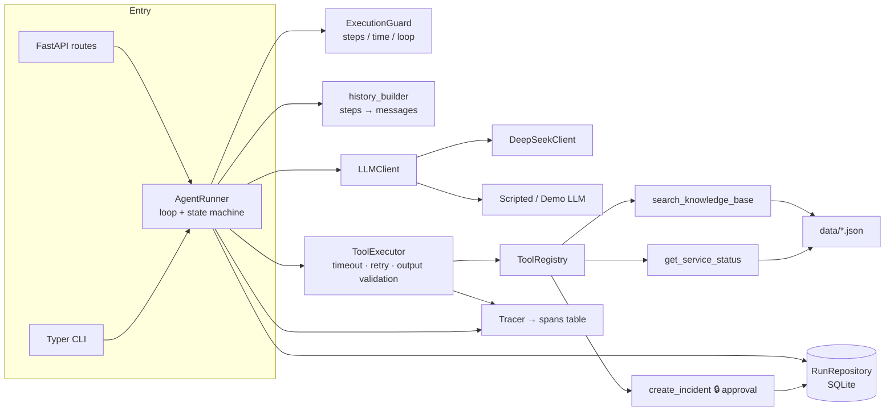
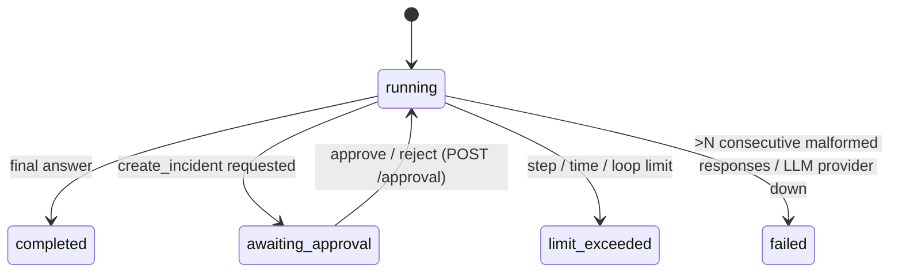

# Ops Agent Harness: Design Report

The harness runs an operations assistant on top of an LLM. It accepts an objective through an API or CLI and runs an LLM ↔ tool loop. It validates tool inputs and outputs, persists state and history, and handles failures. It enforces limits, requires human approval before creating an incident, and writes logs and traces.

## Table of contents
1. Goals & scope
2. Technology stack
3. Architecture
4. Agent loop & state machine
5. Tool integration & validation
6. Error handling, retries, timeouts, malformed responses
7. Safety controls
8. Database design
9. Observability
10. Testing (incl. how to run and test)
11. API & Postman collection
12. Environment variables
13. Limitations
14. Future improvements
15. Mock dataset

---

## 1. Goals & scope

| Requirement | Where it is handled |
|---|---|
| Accept an objective via API / CLI | `POST /runs` (FastAPI) and `harness run` (Typer) both call the same `AgentRunner` |
| LLM–tool execution loop | `app/core/runner.py` |
| Validate tool inputs and outputs | Pydantic input/output models per tool (`app/tools/`); LLM output parsed into typed decisions (`app/llm/parser.py`) |
| State and execution history | SQLite tables `runs`, `steps`, `tool_calls`, `approvals`, `spans` |
| Tool errors, timeouts, retries, malformed LLM responses | `app/core/executor.py`, `app/core/retry.py`, runner feedback loop |
| Infinite-loop prevention | `app/core/guards.py`: step limit, active wall-time limit, identical-call loop detection |
| Approval before `create_incident` | `requires_approval` tool flag → run pauses → `POST /runs/{id}/approval` |
| Logs / traces per execution | structlog JSON logs; spans persisted and served by `GET /runs/{id}/trace` |
| Tests | pytest suite with a scripted LLM, temporary SQLite and a fake clock (offline, deterministic) |

**Deliberate choice: no agent framework.** LangGraph, the OpenAI Agents SDK and similar frameworks would hide the parts this assessment grades: the loop, state, failure handling and safety. I borrowed their patterns instead. The approval flow follows the OpenAI Agents SDK model: the run pauses, the paused state is persisted, and it resumes later. Span names follow the OpenTelemetry GenAI conventions.

## 2. Technology stack

| Layer | Choice | Why |
|---|---|---|
| Language | Python ≥ 3.10 (3.12 in Docker) | mature LLM SDKs, fast to iterate |
| API | FastAPI + uvicorn | async; generates the OpenAPI spec (`/docs`) automatically; native Pydantic |
| Validation | Pydantic v2 | one modelling layer for tool schemas, LLM decisions and API DTOs. Tool JSON schemas for the LLM come from the same models. |
| Persistence | SQLAlchemy 2.0 async + SQLite (aiosqlite, WAL mode) | no setup; switching to Postgres only needs `DATABASE_URL` |
| LLM | DeepSeek `deepseek-v4-flash` through the `openai` SDK (OpenAI-compatible API, native tool calling) | low cost and fast; non-thinking mode by default |
| Offline LLM | `ScriptedLLM` (tests) / `DemoScenarioLLM` (demo) | deterministic tests; graders can run everything without an API key |
| CLI | Typer | thin wrapper over the same runner |
| Logs | structlog (JSON lines) | `run_id` and `span_id` attached to every event |
| Tests | pytest, pytest-asyncio, httpx ASGI transport, Newman for Postman | standard tools |

## 3. Architecture



`app/container.py` is the single place where components are wired together, and both the API and the CLI use it. Tests inject a scripted LLM, a fake clock and a no-op sleep through it.

## 4. Agent loop & state machine



**A segment** is one stretch of execution. `start()` runs the first segment and `resume()` runs every later one. Each segment does the following:

1. **Drain queued tool calls.** These are calls left over from an LLM response that was interrupted by an approval pause.
2. **Loop:**
   - Check the step and wall-time budget.
   - Rebuild the message history from persisted `steps`.
   - Call the LLM and parse its reply into a `ToolCallsDecision` or a `FinalAnswerDecision`.
   - On a **final answer**: store it, mark the run `completed` and stop.
   - On **tool calls**: persist all calls as `queued`, then run them **sequentially in the order the LLM returned them**. Each call goes through, in order: the loop check, a registry lookup, input validation, the approval gate, and then execution.
3. **On `create_incident`:** the call becomes `pending_approval`, the run becomes `awaiting_approval` and the segment ends. Later calls from the same LLM response stay `queued`. They run after the human decision, so every tool call still gets exactly one result before the next LLM request, as the OpenAI tool-calling protocol requires.

**State is persisted at every transition.** The LLM conversation is never kept in memory: `history_builder` rebuilds it from the `steps` table on every iteration. A paused run can therefore be resumed by a different request, a new process, or after a restart.

**Status changes are compare-and-set** (`UPDATE … WHERE status = ?`). Two concurrent approval requests cannot both execute the call. A per-run `asyncio.Lock` provides a second layer of protection inside the process.

**A step** is one LLM decision. Malformed responses count as steps, so a model that keeps answering badly still runs into the step limit.

## 5. Tool integration & validation

Each tool declares the following (`app/tools/base.py`):
- `input_model`: a Pydantic model with `extra="forbid"`, so parameters the model invents are rejected. Constraints include patterns, length limits and `Literal` severities.
- `output_model`: the harness validates what the tool returns. A tool that drifts from its contract (`broken-service`) becomes a `tool_output_invalid` observation and never reaches the LLM as bad data.
- `requires_approval`: the flag that gates execution.
- `spec()`: the OpenAI function schema, generated from `input_model`.

LLM output is validated too (`app/llm/parser.py`):
- Every tool call needs an `id` and a name.
- `arguments` must be a JSON *object*.
- The reply must contain either content or tool calls.
- There can be at most `MAX_TOOL_CALLS_PER_STEP` calls.

If a check fails, the whole response is rejected as malformed (see §6).

Validation errors are shortened to a readable message, e.g. `severity: Input should be 'low', 'medium', 'high' or 'critical'`. The model receives this text so it can correct itself.

## 6. Error handling, retries, timeouts, malformed responses

| Failure | Class / code | Retried? | What the LLM sees | Run outcome |
|---|---|---|---|---|
| Tool timeout (`asyncio.wait_for`) | `ToolTimeoutError` / `tool_timeout` | yes, exponential backoff | `{"ok":false,"error":{code,message}}` once retries are exhausted | continues |
| Transient tool error (e.g. backend 503) | `ToolTransientError` | yes | only if retries are exhausted | continues |
| Permanent tool error (unknown service) | `ToolExecutionError` | no | error observation | continues |
| Invalid tool arguments | `ToolInputValidationError` | no | error with field-level message | continues; the model can fix the call |
| Unknown tool | `ToolNotFoundError` | no | error plus the list of available tools | continues |
| Invalid tool output | `ToolOutputValidationError` | no | error observation | continues |
| Unexpected exception in a tool | caught | no | generic `tool_execution_error` (no stack trace) | continues |
| Malformed LLM response | `LLMMalformedResponseError` | feedback retry: a corrective message is added; the invalid output is *not* replayed | "Your previous response was invalid: …" | `failed` after more than `MAX_MALFORMED_LLM_RESPONSES` in a row |
| LLM transport error (timeout, 429, 5xx) | `LLMProviderError` | yes, inside the client (`LLM_MAX_RETRIES`) | — | `failed` (`llm_provider_error`) once exhausted |
| Step / time / loop limit | `StepLimitExceeded` / `TimeLimitExceeded` / `LoopDetected` | — | — | `limit_exceeded` with the reason; unfinished tool calls are marked `failed` |
| Any unexpected exception (bug, DB error) | caught at the segment boundary | — | — | `failed` (`internal_error`). A run is never left stuck in `running`. |

There are two kinds of retry, and they are kept separate:
- **Transport retries** cover timeouts and transient errors. They are hidden from the model.
- **Feedback retries** cover malformed output. The model is told what was wrong, and these retries count toward the step budget.

Every terminal path writes `error_code` and `error_detail`, or `final_answer`, and appends a `run_error` or `final_answer` step.

## 7. Safety controls

- **Approval gate.** A tool with `requires_approval` is never executed by the loop itself. Its call is stored as `pending_approval`, and the run returns 202 with `pending_approval {tool_call_id, tool, args}`. The approval request must name that exact `tool_call_id`; otherwise the harness returns 409 `approval_mismatch`. A second decision returns 409 `approval_not_pending`. Edited arguments are validated again against the tool's input model (422 if invalid, and the run stays paused). Approve, reject, edit, reason and approver are recorded in the `approvals` table and as steps.
- **Reject path.** The model receives `rejected_by_user` as the tool result, and the system prompt tells it not to retry. The model then writes a final answer.
- **Idempotent side effect.** `create_incident` uses the idempotency key `run_id:tool_call_id`, which is unique in the `incidents` table. If the call is executed again for the same tool call, the existing incident is returned with `deduplicated: true` and no duplicate is created.
- **Loop prevention.**
  - Step limit (`MAX_STEPS`, can be overridden per run up to 50).
  - Active wall-time limit (`MAX_WALL_TIME_S`). This is a **hard deadline**: every LLM call and tool execution runs under `asyncio.wait_for(remaining budget)`, so a slow call is cancelled rather than overrunning. Time spent waiting for a human is excluded, because each segment adds its own duration to `runs.active_elapsed_s`.
  - Loop detection: the `LOOP_DETECT_THRESHOLD`-th call with the same tool and identical canonical arguments aborts the run.
- **Bounded fan-out.** At most `MAX_TOOL_CALLS_PER_STEP` tool calls per LLM response. Tool-call ids that the model reuses are renamed, so the replayed history stays protocol-valid.
- **Truthful approval context.** When the operator edits the arguments, the tool result tells the model which arguments were actually executed (`executed_args`). The final answer then reports what really happened.
- **Prompt injection.** Knowledge-base content goes to the model as tool output. Text inside the KB could try to make the model open incidents. The approval gate is the backstop: no side effect happens without a human decision.
- **Secrets.** The API key is a `SecretStr` and never appears in logs. Log fields with sensitive names are redacted, and large payloads are truncated.

## 8. Database design

```mermaid
erDiagram
  runs ||--o{ steps : has
  runs ||--o{ tool_calls : has
  runs ||--o{ approvals : has
  runs ||--o{ spans : has
  runs ||--o{ incidents : creates
  runs { string id PK; text objective; string status; text final_answer; string error_code; text error_detail; int step_count; int max_steps; float max_wall_time_s; float active_elapsed_s; string llm_provider; string llm_model; datetime created_at; datetime completed_at }
  steps { int id PK; string run_id FK; int idx "unique per run"; string type; json payload; datetime created_at }
  tool_calls { int id PK; string run_id FK; string call_id "unique per run"; int step_idx; int seq; string tool_name; json args; string args_hash; string status; json result; string error_type; int attempts; int duration_ms }
  approvals { int id PK; string run_id FK; string call_id; string decision; json edited_args; text reason; string decided_by; datetime decided_at }
  spans { string id PK; string run_id; string parent_id; string name; string kind; string status; json attributes; bigint start_ns; bigint end_ns }
  incidents { string id PK "INC-xxxxxxxx"; string title; text description; string severity; string status; string idempotency_key UK; string run_id }
```

- **`steps`** is the append-only execution history and the single source of truth for the LLM conversation. Step types:
  - `llm_response`: the assistant message, stored exactly as received, with usage and latency.
  - `llm_malformed`: the reason and the raw output.
  - `tool_result`: the observation, attempts and duration.
  - `approval_requested` and `approval_decided`.
  - `final_answer` and `run_error`.
- **`tool_calls`** holds per-call state (`queued → pending_approval/running → succeeded/failed/rejected`), ordered by `(step_idx, seq)`. `args_hash` is a SHA-256 of the tool name plus canonical JSON arguments, and is used for loop detection.
- **`incidents`** plays the "external incident system". Its unique `idempotency_key` prevents duplicates.

## 9. Observability

**Logs** are JSON lines produced by structlog. `run_id` and `span_id` are bound through contextvars. Events:
- `run.started`, `run.finished`
- `llm.request`, `llm.response`, `llm.malformed`
- `tool.call`, `tool.retry`, `tool.result`
- `approval.requested`, `approval.decided`
- `limit.exceeded`

```json
{"tool": "get_service_status", "call_id": "call_demo_0_0", "retry": 1, "error": "status backend temporarily unavailable (attempt 1)", "event": "tool.retry", "run_id": "ea399834-…", "span_id": "cc91560ead8a4d50", "level": "warning", "timestamp": "2026-11-05T12:43:24.122903Z"}
```

**Traces** use span names and attributes from the OpenTelemetry GenAI semantic conventions:
- Span names: `invoke_agent ops-assistant` (one root per segment, `harness.segment=start|resume`), `chat <model>` and `execute_tool <tool>`.
- Attributes: `gen_ai.operation.name`, `gen_ai.request.model`, `gen_ai.usage.input_tokens/output_tokens`, `gen_ai.tool.name`, `gen_ai.tool.call.id`, `harness.attempts`.
- A failed tool sets span status `error` and `error.type`.

Spans are stored in the `spans` table and returned as a tree by `GET /runs/{id}/trace` (or `harness trace <id>`), so no external collector is needed. If `OTEL_EXPORTER_OTLP_ENDPOINT` is set and the `otel` extra is installed, spans are also exported over OTLP.

```
invoke_agent ops-assistant (segment=start)
├── chat scripted
├── execute_tool get_service_status
├── chat scripted
├── execute_tool search_knowledge_base
└── chat scripted                       → requests create_incident → pause
invoke_agent ops-assistant (segment=resume, approval=approve)
├── execute_tool create_incident
└── chat scripted                       → final answer
```

## 10. Testing

### 10.1 How to run and test

Requires Python 3.10 or newer.

```bash
# install
make install                  # creates a venv and installs the app + dev dependencies
cp .env.example .env          # optional; blank values mean "unset"

# run (offline demo, no API key)
make run                      # API on http://localhost:8000, OpenAPI UI at /docs
.venv/bin/harness run "Check the status of payments-api"            # CLI
.venv/bin/harness run "checkout-web is down, create an incident"    # prompts approve / reject / edit

# real LLM (DeepSeek)
LLM_PROVIDER=deepseek DEEPSEEK_API_KEY=... make run

# test
make test                     # offline suite, about 15 s
make coverage                 # with coverage report
make lint                     # ruff
make test-live                # optional live DeepSeek smoke test (needs DEEPSEEK_API_KEY)
npx newman run postman/ops-agent-harness.postman_collection.json \
  -e postman/ops-agent-harness.postman_environment.json   # server must be running
```

The full command list, with API examples and Docker, is in the [README](../README.md).

### 10.2 Test design

`make test` runs the suite. It needs no network:
- `ScriptedLLM` replays OpenAI-format assistant messages through the real parser.
- Each test gets its own SQLite file.
- A fake clock makes the time-limit tests instant.
- Short tool timeouts (0.05 s) keep the timeout tests fast.

| Area | Cases (examples) |
|---|---|
| Success | status check → final answer; KB + status → final answer; history order |
| Tool failure | flaky service recovers after 2 retries; slow service times out → observation → final answer; invalid tool output; unknown tool; invalid args fed back and corrected |
| Approval | pause with no side effect; approve → exactly one incident; reject → none; valid and invalid edited args; wrong `tool_call_id` (409); double decision (409); resume after "restart" (new runner, same DB); approval wait excluded from wall time; create_incident in the middle of a multi-call response |
| Limits | step limit; wall-time limit; loop detection; per-run `max_steps` override |
| Malformed LLM | one malformed reply then recovery (corrective message checked); N+1 in a row → failed; provider error → failed |
| Units | parser, retry and backoff, guards, tools, scripted LLMs, history builder |
| API / tracing | all endpoints and status codes; span tree shape; error spans |

**Latest results:**
- **pytest:** 158 passed in about 15 s.
- **Coverage:** 94% overall; `app/core` 96–100%; `app/tools` 98–100%.
- **Postman (Newman), against a live server in scripted mode:** 25 requests, 38 assertions, 0 failures.
- **Docker image:** builds and starts.

- **Live DeepSeek (`deepseek-v4-flash`):** the smoke test passes. Manual runs covered a status check, a KB question, tool faults, approve and reject of `create_incident`, and thinking mode.

## 11. API & Postman collection

The endpoint table is in the [README](../README.md#using-the-api). OpenAPI is available at `/docs`.

The collection is `postman/ops-agent-harness.postman_collection.json`, with the environment file `postman/ops-agent-harness.postman_environment.json` (`base_url`). Each request has test scripts, and `run_id` / `tool_call_id` are captured automatically. Folders:
- `0` Health & tools
- `1` Happy path
- `2` Incident approve (with edit, then a double-approve that returns 409)
- `3` Incident reject (wrong id 409, invalid edit 422)
- `4` Failure handling (flaky, slow, broken services)
- `5` Execution limits (`max_steps: 1`, loop detection)
- `6` Inspect

## 12. Environment variables

See the [README table](../README.md#environment-variables) and `.env.example`. With all defaults the harness runs fully offline (`LLM_PROVIDER=scripted`). Only `DEEPSEEK_API_KEY` is needed for the real LLM.

## 13. Limitations

- **Synchronous execution inside one HTTP request.** This is a prototype decision. A long real-LLM run holds the HTTP connection open. `MAX_STEPS` and `MAX_WALL_TIME_S` bound it, but clients need a generous timeout.
- **Single process.** The per-run lock is in memory. The compare-and-set status updates prevent double approval, but running several workers would need a distributed lock or a queue.
- **SQLite.** Concurrent writes are limited, even with WAL mode.
- **Process crash mid-segment.** Handled exceptions always end the run in a defined status. A hard process kill is different: if the process dies while a tool runs, or between the separate transactions of an approval step, the run stays `running`. There is no reaper job yet. `create_incident` is idempotent, so retrying it is safe.
- **Tool calls in one LLM response run sequentially**, not in parallel.
- **Mock tools.** Knowledge-base search is keyword overlap, not semantic. Faults are tied to fixed service names.
- **Scripted demo provider.** It is keyword-routed and its answers are canned. It shows the harness mechanics, not reasoning.
- **No authentication or RBAC.** Anyone who can reach the API can approve.
- **No token or cost budget**, and no streaming of intermediate steps.
- **DeepSeek thinking mode** (`DEEPSEEK_THINKING=true`) is implemented from the docs, which say `reasoning_content` is replayed with tool calls. It was not tested against the live API.

## 14. Future improvements

1. **Asynchronous runs.** `POST /runs` returns 202 immediately. A worker (Arq, Celery or a Postgres queue) runs the segments. Clients poll, or subscribe over SSE or WebSocket to stream steps. A reaper handles stuck `running` runs.
2. **Postgres**, row-level locks (`SELECT … FOR UPDATE`) and Alembic migrations.
3. **Approver identity and RBAC.** Approval through Slack or Teams, approval expiry, and policy rules (for example, auto-approve `low` severity and require two approvers for `critical`).
4. **Real integrations** behind the same `Tool` interface: a status page or monitoring API, PagerDuty or Opsgenie, and a vector KB (pgvector) with source citations.
5. **Token, cost and latency budgets** per run, and context-window management (summarizing long histories).
6. **Run independent tool calls in parallel**, keeping approval-gated calls sequential.
7. **A full OpenTelemetry pipeline** (Jaeger, Tempo or Langfuse), plus metrics: tool error rate, retries and approval latency.
8. **An evaluation suite**: recorded LLM transcripts as regression fixtures, and objective → expected-tool-sequence checks against several models.
9. **Multiple LLM providers**, with fallback when one is down.
10. **Incident deduplication** across runs (for example, one open incident per service).

## 15. Mock dataset

The dataset is in the repository under `data/`. A public copy is at:

- `data/knowledge_base.json`: 16 runbooks and policies. They include runbooks for each service, the severity matrix, the incident creation policy, escalation, rollback, comms and a postmortem template.
- `data/service_statuses.json`: 11 services, including the fault-injection services `flaky-service`, `slow-service` and `broken-service`.
- `data/scenarios/*.json`: offline demo scenarios for `LLM_PROVIDER=scripted`.

`make dataset` builds `dist/mock-dataset.zip` for upload.

**Google Drive:** https://drive.google.com/file/d/1rxoCSOcVbbuWpIOz90-cRo0-qfzcfElJ/view?usp=sharing